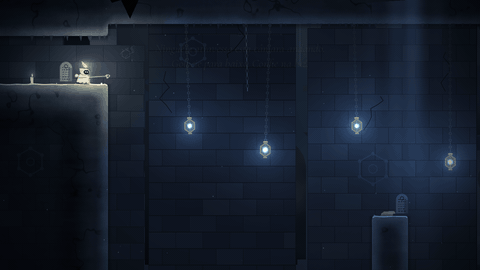
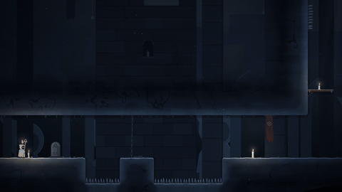

<div align="center">

# VELA

**Um metroidvania sobre aura, votos e velas apagadas.**

Você é uma peregrina de cera — uma vela viva, com uma chama de aura no pavio e um cajado de anéis —
que cai em **Vesperal**, o mosteiro-cidade onde todos os praticantes de Nen se apagaram de uma vez.



*Etapa 1 · Movimentação* — [Roadmap](docs/ROADMAP.md) · [Documento de design](docs/GDD.md) · [Devlog](docs/devlog/etapa-01.md)

</div>

---

## Jogar

**No navegador:** <https://wyllye.github.io/vela/> (publicado pelo GitHub Actions a cada push na `main`).

**No Godot:**
1. Instale o [Godot 4.7](https://godotengine.org/download) (versão padrão, sem .NET).
2. Abra o Godot → **Importar** → escolha o `project.godot` desta pasta.
3. Aperte **F5**.

## Controles

| Ação | Teclado | Controle |
|---|---|---|
| Mover / mirar | ← → ↑ ↓ ou WASD | Analógico / direcional |
| Pular (segure para ir mais alto) | Z ou Espaço | A |
| Golpe do cajado (↓ no ar = pogo) | X ou J | X |
| Passo de Ren (dash) | C, K ou Shift | RB / RT |
| Pausa | Esc ou P | Start |
| Música liga/desliga | M | — |
| Depuração (hitbox, números) | F3 | — |

## O que já existe (Etapa 1)

- **Movimentação no nível das referências:** corrida que chega à velocidade máxima em ~0,07 s, pulo variável com ápice suave e queda mais pesada, *coyote time*, *buffer* de pulo, **Passo de Ren** (dash) com pulo-cancelado que conserva impulso, **Aderência** (deslizar e pular na parede), **Sopro** (pulo aéreo), golpe em 3 direções, **pogo** em espinhos e lanternas, correção de quina na cabeça e no dash.
- **O Poço do Despertar:** 4 salas com transições, a queda e o despertar da intro, estelas que contam a história sem diálogo, o altar que fecha a etapa.
- **Arte procedural:** a Vela, o terreno, os fundos em camadas, a luz 2D e as partículas são desenhados em código — sem nenhuma imagem pronta.
- **Música composta em código:** piano de feltro, cordas, coro, sinos e tigelas tibetanas sintetizados em Python (`tools/audio`), mais 20 efeitos sonoros. O som do jogo é o tilintar dos anéis do cajado.
- **27 testes automáticos** da física e das salas, rodando no CI.



## Como o projeto está organizado

```
levels/            salas em JSON com mapa ASCII (legenda em levels/README.md)
locale/textos.csv  todos os textos do jogo, inclusive os nomes do sistema de Nen
resources/         movement_tuning.tres — todos os números da sensação de movimento
scenes/            main.tscn (jogo) e player.tscn (a Vela)
scripts/
  core/            física em grade (LevelGrid), controles, dados das salas
  player/          controle da Vela, desenho procedural, rastro do dash
  world/           montagem das salas, terreno, fundos, névoa, luz, props
  camera/  ui/  fx/  autoload/
shaders/           pedra, névoa, feixes de luz, vinheta
tests/             testes headless (godot --headless -s res://tests/run_tests.gd)
tools/             gerador do Input Map e a síntese da trilha (tools/audio)
docs/              GDD, roadmap e devlog de cada etapa
```

## Mexendo no jogo

- **Sensação do movimento:** abra `resources/movement_tuning.tres` no Inspector do Godot. Cada número tem descrição (velocidade, gravidade, coyote time, dash...).
- **Salas:** edite os mapas em `levels/*.json` — `#` é rocha, `=` plataforma, `^` espinho, letras são objetos. A legenda completa está em [`levels/README.md`](levels/README.md).
- **Textos:** `locale/textos.csv`.
- **Música e efeitos:** `python3 tools/audio/build_audio.py` regenera tudo (precisa de numpy, scipy e ffmpeg).
- **Testes:** `godot --headless --path . --import` e depois `godot --headless --path . -s res://tests/run_tests.gd`.
- **Ver uma sala direto:** `godot --path . -- --room=lanternas --at=6,6` (pula título e intro).

## Créditos

- Jogo de fã, sem fins comerciais. O sistema de habilidades é inspirado no **Nen** de *Hunter x Hunter*, de Yoshihiro Togashi. Mundo, personagens, textos, arte e música de VELA são originais.
- Referências de jogo: *Hollow Knight* (Team Cherry) e *Constance* (btf).
- Fontes: [Cinzel](https://github.com/NDISCOVER/Cinzel) e [Cormorant Garamond](https://github.com/CatharsisFonts/Cormorant), sob a SIL Open Font License (`assets/fonts/`).
- Feito em [Godot Engine](https://godotengine.org).
