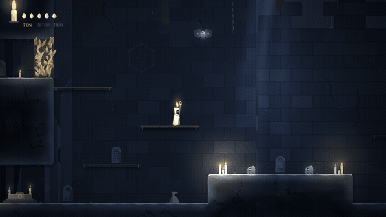
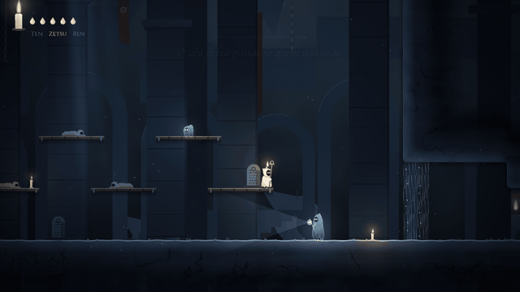

# Devlog — Etapa 2: Combate e fundamentos do Nen

> 11/10/2026 · Godot 4.7.2 · 50 testes passando

## O que entrou

**Vitalidade e Aura.** A Vela tem 5 gotas de cera (a vida) e a chama (a aura, 100 pontos). Tudo está em `resources/nen_tuning.tres`.

| | Como ficou |
|---|---|
| Passo de Ren (dash) / Sopro (pulo aéreo) | custam 18 / 14 de aura; pulo de parede e golpe são de graça |
| Regeneração | 70/s parada no chão, 34/s andando, 6/s no ar, depois de 0,35 s sem gastar |
| Absorver | acertar um Eco devolve 9 de aura (no pogo também); quicar em lanterna ou espinho devolve 6 |
| Derreter | com a chama zerada, dash e Sopro ainda saem, mas derretem uma gota — nunca a última |
| Golpe recebido | 1 gota, empurrão, 0,22 s sem controle e 1,1 s de invencibilidade (piscando) |
| Espinho | 1 gota e volta ao último chão seguro; com a última gota, apaga |

**A chama é a interface.** A chama da Vela cresce e encolhe com a aura, tremula e esfria quando falta, escorre antes do Ten, vira brasa no Zetsu e explode num manto de chama no Ren. No canto da tela, uma vela pequena repete isso (com uma chama-fantasma mostrando quanto a aura máxima ainda comporta) e as gotas ficam ao lado; a gota perdida derrete e cai.

**Ten, Zetsu e Ren.**

| Técnica | Como funciona |
|---|---|
| **Ten** | A Vela acorda **vazando**: a chama segura só 45% da aura, ela escorre sem parar e todo golpe fere em dobro. O altar do Fundo do Poço ensina o Ten, que fica sempre ativo depois |
| **Zetsu** (segurar Shift · LB/LT) | A chama apaga e o mundo escurece e abafa. Os Ecos perdem a Vela em 0,35 s; véus de aura deixam passar; a aura volta a 45/s até no ar. Em troca: sem dash, Sopro ou Ren, anda a 80% e **cada golpe recebido fere em dobro**. Dentro de um véu, a chama não reacende |
| **Ren** (segurar V/L · Y) | Apertar explode a aura (raio de 120 px, custa 12): racha cascas de aura, fere e afasta os Ecos. Segurando, o cajado fere em dobro e a Vela corre 12% mais, mas a aura se esvai a 18/s |

**Combate.** Golpe com hit-stop (0,05 s; 0,08 s nos golpes fortes), recuo da Vela, Eco empurrado e atordoado. Atacar um Eco **desatento** — pelas costas, ou saindo do Zetsu — fere 1 a mais. Tudo isso conversa: Zetsu para chegar sem ser visto, golpe pelas costas, Ren quando eles se juntam.

**Os Ecos.** São o Nen póstumo dos monges, presos ao último voto — e o voto é o comportamento:

| Eco | Voto | Comportamento |
|---|---|---|
| **Vigia** | guardar o sono dos noviços | Patrulha diante da porta com a lanterna; só vê para a frente, na faixa do facho; investe a 410 px/s contra a chama que vê e não para com golpe no meio da investida. 3 de vida |
| **Saltador** | nunca mais tocar o chão do Poço | Não para de pular; quando vê a chama, salta em cima dela. Dá para quicar nele. 2 de vida |
| **Mariposa** | velar toda chama acesa | Ronda a chama a ~140 px e mergulha nela a 520 px/s; no Zetsu, volta a pairar. 2 de vida |
| **Eco póstumo** | o da própria Vela | Aparece onde ela apagou, guardando 34% da aura máxima; sente a Vela até no Zetsu; vencê-lo devolve tudo. 4 de vida |

**Morte.** A Vela derrete, a tela escurece e ela renasce no último altar em que descansou, com as gotas cheias e a chama menor. O Eco póstumo fica onde ela caiu (ou no último chão seguro, se foi em espinho). Apagar de novo troca o Eco de lugar — a perda não acumula.

**Salas.** O caminho agora é Fundo do Poço → **Dormitório dos Noviços** → Galeria → Lanternas → **Câmara dos Votos** → Limiar.
- *Fundo do Poço*: ganhou o altar do Ten, ao lado de onde a Vela acorda.
- *Dormitório dos Noviços* (Zetsu): beliches com noviços que nunca acordaram, Saltadores no alto e o Vigia guardando o véu da saída. Dá para lutar com ele, mas o véu só deixa passar quem não arde.
- *Câmara dos Votos* (Ren): Saltadores no tablado dos votos, Mariposas no alto, o Vigia no chão e a saída lá em cima, lacrada por uma casca de aura. Uma alcova secreta atrás de outra casca guarda uma inscrição sobre o voto da Abadessa (e uma escrita em aura para o Gyo, na Etapa 3).

Cada altar ensina a lição dele e as que tiverem ficado para trás; descansar enche gotas e chama e marca onde a Vela renasce.

**Som.** 21 efeitos novos sintetizados em `tools/audio/sfx.py`. Os sons dos Ecos têm eco de verdade (repetições cada vez mais escuras); o Eco póstumo acorda com os anéis da própria Vela tocados ao contrário. No Zetsu, música e ambiência passam por um passa-baixa.

## Decisões

- **Zetsu e Ren são de segurar.** Esconder dura enquanto se segura; o Ren explode ao apertar e se mantém enquanto se segura, gastando. Shift saiu do dash e virou Zetsu.
- **"Dano dobrado" do Zetsu é o recebido**, como no GDD. Para a furtividade compensar, golpe num Eco desatento fere 1 a mais.
- **Um altar ensina as lições que faltam**, em ordem — ninguém fica preso sem Ten por ter passado direto pelo primeiro altar.
- **Os Ecos voltam quando a Vela sai e entra na sala.** O descanso ainda não "repõe o mundo"; isso entra junto com o save na Etapa 5.
- **Os Ecos não recebem luz**: são aura, não cera, e brilham sozinhos com uma silhueta fria.

## Bugs que os testes e as capturas pegaram

- Um método `_set` nos Ecos batia com o `Object._set` do Godot (erro de assinatura) — renomeado.
- Depois de voltar de um espinho, a invencibilidade curta anulava o dano do espinho seguinte: dava para ficar quicando nele para sempre. Agora o espinho só não fere quando a Vela foi empurrada para ele por um Eco (a gota já foi).
- Na Câmara dos Votos, o pulo do tablado para a plataforma da direita ficava 6 px curto. O teste de rota pegou; a plataforma veio uma célula para perto.
- O Vigia estava da altura da Vela e não metia medo: ganhou um capuz mais alto.

## Próximo: Etapa 3

Técnicas avançadas: **Gyo** (a escrita em aura já plantada no Poço e na alcova da Câmara dos Votos), **En** (revelar a sala), **Shu**, **Ko** e **Ken** no combate, e o primeiro mural do Juramento.
